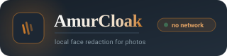
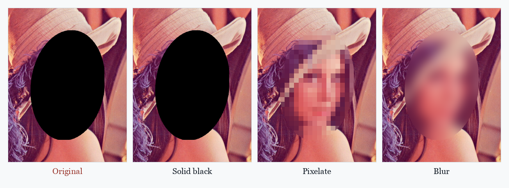
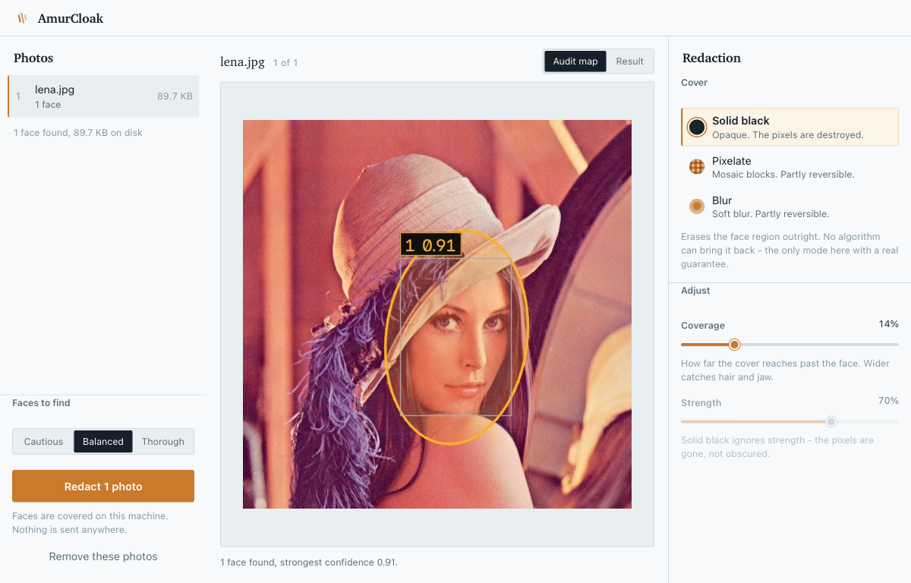

<div align="center">



# AmurCloak

**Find every face in a photo and cover it — on your own machine, with the network unplugged.**

No uploads, no accounts, no telemetry. Drop photos in, check the map, download redacted copies.

[](https://www.python.org/)
[](#requirements)
[](#quick-start)
[](#testing)
[](#requirements)
[](#why-amurcloak)
[](src/amurcloak/models/)

[Quick Start](#quick-start) · [Why](#why-amurcloak) · [Features](#features) · [Configuration](#configuration) · [Testing](#testing)

</div>

---

## Why AmurCloak?

- **Your photos never leave the machine.** There is no server to upload to, no cloud API behind a spinner, and no outbound request anywhere in the runtime — the only socket the program opens is a loopback check of its own port, to tell "already running" apart from "free port". You can pull the network cable out mid-batch and nothing changes.
- **One detection pass is not enough for group photos.** A single frame inference reliably misses the small faces at the back of a crowd. AmurCloak also scans overlapping tiles and merges the results — on the 10-face test fixture that is the difference between finding 1 face and finding 4.
- **The default mode is the one that cannot be undone.** Solid black destroys the pixels. Pixelate and blur are *partially reversible* and are labelled as such in the interface, because "AI un-pixelation" is a real and published technique.
- **It costs you nothing to leave running.** Every transient byte lives under one temp root: batches stream into a ZIP one file at a time, staged inputs are freed the moment you download, and a reaper clears idle sessions. Steady-state disk usage is zero.

---

## What it looks like

The default mode, next to the two softer ones — so the trade-off is visible rather than assumed:



The **audit map** shows you what was found before you commit to anything. If a face is visible here, you know it is covered; if someone is missed, you can see that too and switch to a more aggressive preset:



---

## Table of Contents

- [Quick Start](#quick-start)
- [Architecture](#architecture)
- [Features](#features)
- [Installation](#installation)
- [Configuration](#configuration)
- [Usage](#usage)
- [Testing](#testing)
- [Repository Structure](#repository-structure)
- [Contributing](#contributing)
- [License](#license)

---

## Quick Start

**One paste.** This installs [uv](https://docs.astral.sh/uv/) — which brings its own Python — and then AmurCloak itself. The `export` is there so it works in the terminal you already have open, with no restart:

```bash
curl -LsSf https://astral.sh/uv/install.sh | sh && export PATH="$HOME/.local/bin:$PATH" && uv tool install amurcloak
```

Windows, in PowerShell — same idea:

```powershell
powershell -ExecutionPolicy ByPass -c "irm https://astral.sh/uv/install.ps1 | iex"; $env:Path = "$env:USERPROFILE\.local\bin;$env:Path"; uv tool install amurcloak
```

**Then, forever after:**

```bash
amurcloak
```

It takes the first free port from 5000, opens your browser, and stops on Control-C. Run it a second time and it notices the copy already running instead of starting another server.

If you would rather not depend on PyPI, each release also attaches the wheel, which is a complete self-contained install:

```bash
uv tool install https://github.com/<owner>/AmurCloak/releases/latest/download/amurcloak-1.0.0-py3-none-any.whl
```

No API keys, no configuration files, no model download — the detector ships inside the package.

---

## Architecture

A single process, one request at a time, no queue and no worker pool:

```text
   photo
     │
     ▼
 ┌─────────────┐   EXIF orientation applied, ICC profile kept,
 │   decode    │   everything else discarded
 └──────┬──────┘
        ▼
 ┌─────────────┐   YuNet (227 KB ONNX, via OpenCV's DNN module)
 │   detect    ├──▶ full-frame pass
 └──────┬──────┘   └─▶ + overlapping tiles when the long edge is large
        ▼             └─▶ NMS, with edge-touching hits ranked down
 ┌─────────────┐
 │    mask     │   ellipse fitted and roll-aligned to the face from
 └──────┬──────┘   the five detected landmarks — not a circle
        ▼
 ┌─────────────┐   black  · opaque, irreversible
 │   redact    │   pixelate · mosaic blocks, partly reversible
 └──────┬──────┘   blur   · Gaussian, partly reversible
        ▼
 ┌─────────────┐   alpha → PNG      .heic/.heif → JPEG
 │   encode    │   .png → PNG       everything else → JPEG q95
 └──────┬──────┘   .tif/.tiff → TIFF
        ▼
   single file, or a ZIP streamed one entry at a time
```

**Colour order is BGR throughout the engine** (OpenCV's convention) and is converted only at the file boundary, so no module has to guess.

---

## Features

| Feature | Description |
|---|---|
| **Three redaction modes** | Solid black, pixelate, and blur — with an honest note on which are reversible. |
| **Tiled detection** | Overlapping crops recover small faces that a single full-frame pass misses. |
| **Audit map** | Annotated preview with numbered boxes, landmark-fitted ellipses, and per-face confidence, so you can verify coverage before rendering. |
| **Roll-aware mask** | The ellipse is aligned to the eye line, so it follows a tilted head instead of clipping the chin. |
| **Metadata stripping** | EXIF, XMP, IPTC and GPS are dropped by default. The ICC profile is kept, so iPhone Display P3 colours survive. |
| **HEIC support** | iPhone photos work directly, via `pillow-heif`. |
| **Nine input formats** | BMP, HEIC, HEIF, JPEG, PNG, TIFF, WebP — outputs keep the original format. |
| **Streaming batches** | Outputs are appended to a `ZIP_STORED` archive and unlinked as they go, so a batch never exists twice on disk. |
| **Automatic cleanup** | Idle sessions are reaped, inputs are freed on download, and orphans are purged at startup. |
| **No outbound network** | No CDN, no webfonts, no telemetry, no cloud API. The interface is plain HTML, CSS and JavaScript with no build step. |

---

## Installation

### Requirements

- **Python 3.11 or newer.** uv supplies one if you do not have it, which matters: a clean macOS ships a 3.9 stub with a 2021-era pip that cannot install these dependencies.
- **macOS, Windows or Linux.** The package is pure Python (`py3-none-any`), so one 251 KB wheel covers all three. The platform-specific weight comes from OpenCV's own published wheels, fetched per machine.
- **~250 MB on first run**, almost all of it OpenCV, into uv's shared cache. Reinstalling, or any other uv project, reuses it.
- **One download, ever.** After the first run the command works with the network off.

Five dependencies, all prebuilt wheels, none of them a framework:

| Package | Why |
|---|---|
| `opencv-python-headless` | DNN inference for YuNet, plus resize/blur/pixelate |
| `numpy` | the pixel maths |
| `flask` | the local web interface |
| `pillow` | decode, encode, EXIF |
| `pillow-heif` | iPhone HEIC/HEIF |

Deliberately absent: **PyTorch**, **onnxruntime**, and any **ffmpeg** binary. YuNet runs through the DNN module OpenCV already ships, which is why the model is 227 KB instead of hundreds of megabytes.

### Install

The Quick Start above is the whole thing. Two other routes, if you want them:

```bash
git clone <this-repository> AmurCloak
cd AmurCloak && uv tool install .                       # from a checkout
uv tool install dist/amurcloak-1.0.0-py3-none-any.whl   # from a wheel you built
```

Upgrading and removing are each one command:

```bash
uv tool upgrade amurcloak
uv tool uninstall amurcloak
```

`uv tool install` gives each tool its own isolated environment and drops a small shim on your `PATH`. It does not touch your system Python, and uninstalling leaves nothing behind.

### Working on the source

The package lives under `src/`, so it imports without being installed:

```bash
uv run python -m amurcloak
```

`requirements.txt` carries the same pins for anyone using plain `pip` instead of uv.

### Verify the model

The detector is vendored inside the package, and its checksum is verified on startup:

```bash
shasum -a 256 src/amurcloak/models/face_detection_yunet_2023mar.onnx
# 8f2383e4dd3cfbb4553ea8718107fc0423210dc964f9f4280604804ed2552fa4
```

---

## Configuration

Everything is a command-line flag. There are no environment variables and no config file.

```bash
amurcloak [flags]
```

Running `amurcloak` with no flags picks the port and opens the browser — that is the intended way to use it. The flags exist for the corners.

| Flag | Default | Notes |
|---|---|---|
| `--host` | `127.0.0.1` | Bind address. Localhost only — do not expose this. |
| `--port` | first free from `5000` | Pass one explicitly to pin it. |
| `--tmp` | the system temp directory | Where uploads and renders are staged. Never inside the package. |
| `--no-open` | off | Do not open the browser. For SSH, scripts and headless runs. |
| `--ttl` | `1800` | Seconds of inactivity before a session is reaped. |
| `--max-age` | `21600` | Hard limit on a session's age, in seconds. |
| `--shred` | off | Zero-fill temp files before unlinking. Slower; costs a full write pass. |
| `--keep-inputs` | off | Keep staged uploads after download instead of freeing them. |
| `--allow-download` | off | Permit a one-time model fetch if the vendored model is missing. |
| `--debug` | off | Flask debug mode. |

### Limits

| Limit | Value |
|---|---|
| Files per batch | 300 |
| Single file | 200 MB |
| Total per upload | 1.5 GB |
| Free-space guard | 3× the upload, plus 512 MB headroom |

An upload that will not fit is refused **before** anything is written, and the error states the reason.

---

## Usage

### The interface

1. **Drop photos** anywhere on the page, paste a screenshot, or click **Choose photos**.
2. **Check the audit map.** Every detection is numbered and scored. Switch to **Result** to see the actual redaction.
3. **Pick a cover mode.** Solid black is selected by default. Adjust **Coverage** to push the mask further past the face, and **Strength** to change the blur or block size — the latter is disabled in black mode, because solid black ignores it.
4. **Choose how hard to look.** Cautious, Balanced or Thorough, which trades false positives against missed faces.
5. **Redact photos**, then **Download**. One photo downloads as a single image; several are bundled into a ZIP.

Settings apply to the whole staged set, and changing any of them invalidates a rendered result rather than letting you download pixels that no longer match what is on screen.

A batch is held in the running server's memory, so quitting `amurcloak` — or leaving a batch untouched past `--ttl` — clears it. The page notices and asks for the photos again rather than leaving a stale preview up, which matters because a frame that no longer matches its settings is worse than no frame at all.

### Presets

| Preset | Confidence | Smallest face | Inference edge | Use it for |
|---|---|---|---|---|
| Cautious | 0.75 | 32 px | 1024 | Fewest false positives. Solo portraits. |
| **Balanced** | 0.65 | 24 px | 1024 | The default. Confident hits plus a tiled scan. |
| Thorough | 0.45 | 16 px | 1280 | Crowds and small faces, at the cost of more false positives. |

### Performance

Detection is tens of milliseconds on a phone-sized photo, and a few hundred milliseconds on a 24 MP frame with tiling. Rendering is dominated by JPEG encoding, not by the mask.

---

## Testing

Two suites, no test framework, no fixtures to download:

```bash
uv run python tests/test_engine.py   # 12/12 — detection, masking, colour, metadata, formats
uv run python tests/test_api.py      # 11/11 — upload, tune, preview, render, download, disk
```

The API suite drives the real Flask app through its test client, so it covers the actual routes rather than mocks.

Notable coverage:

- Tiling recovers strictly more faces than a single pass on the group fixture.
- Pixelate and blur **keep the photo's colours** and never composite against black.
- Solid black writes pure black across the whole masked region.
- Every facial landmark falls inside the mask.
- Outputs carry no EXIF, GPS or camera metadata.
- Changing settings invalidates a stale result.
- The temp spool survives startup and a real multi-megabyte upload, and the orphan purge spares reserved folders.

The last two exist because both were real bugs — an upload that silently failed with a 500, and a purge that deleted the directory Werkzeug spools uploads into.

---

## Repository Structure

```text
AmurCloak/
├── README.md
├── pyproject.toml                # metadata, the 5 dependencies, the entry point
├── requirements.txt              # the same pins, for plain pip
├── src/
│   └── amurcloak/
│       ├── __init__.py           # version
│       ├── __main__.py           # python -m amurcloak
│       ├── cli.py                # free-port search, already-running check, browser
│       ├── app.py                # Flask routes, config, flags, lifecycle
│       ├── engine/
│       │   ├── detector.py       # YuNet wrapper: tiling, NMS, ranking
│       │   ├── redact.py         # ellipse geometry, three modes, audit map
│       │   ├── photo.py          # decode/encode, EXIF, metadata stripping
│       │   ├── pipeline.py       # full-resolution preview composition
│       │   ├── presets.py        # modes, presets, settings resolution
│       │   ├── sessions.py       # staging, disk accounting, renderer, reaper
│       │   └── __init__.py
│       ├── models/
│       │   └── face_detection_yunet_2023mar.onnx   # 227 KB, checksum verified
│       ├── templates/
│       │   └── index.html        # the single page
│       └── static/
│           ├── style.css         # the whole stylesheet
│           └── app.js            # the whole front end, no build step
├── assets/                       # logo and screenshots
└── tests/
    ├── test_engine.py            # 12 tests
    ├── test_api.py               # 11 tests
    └── fixtures/                 # lena.jpg, plus fixtures built on demand
```

---

## Contributing

This is a private tool, so there is no contribution process to speak of. If you do extend it, three rules keep it honest:

1. **Nothing may make an outbound network call at runtime.** That is the entire point of the project. The one request AmurCloak ever makes is a loopback probe of its own port, to tell "already running" apart from "free port" — it is pinned to `127.0.0.1` and deliberately ignores any proxy set in the environment, so it cannot become an outbound request by accident.
2. **A preview must never disagree with the delivered file.** Previews are composed at full resolution and only then downscaled — shrinking first would change the blur kernel and the block size.
3. **Never describe a reversible redaction as safe.** If a mode can be partially undone, the interface has to say so.

Run both suites before committing; they are fast enough that there is no excuse not to.

---

## License

**Not yet chosen.** This repository has no `LICENSE` file, which legally means all rights are reserved and nobody may reuse it. If you intend to share or publish AmurCloak, pick one — MIT or Apache-2.0 are the usual choices for a tool like this, and the vendored YuNet model carries its own upstream licence that is worth checking first.

---

<div align="center">
<sub>Built to be used once and trusted: the photos go in, the faces come out covered, and nothing in between leaves the machine.</sub>
</div>
